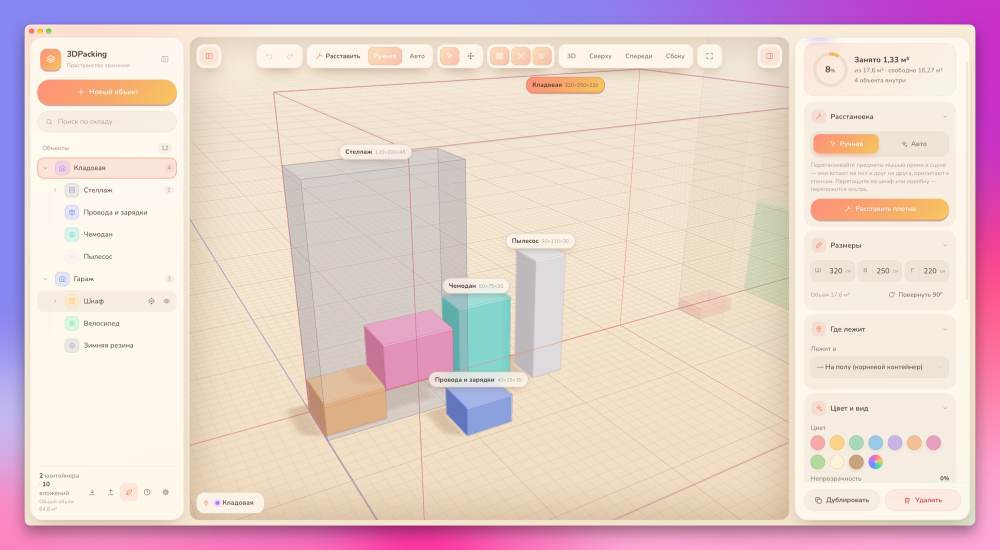

<p align="center">
  
</p>

<h1 align="center">3DPacking</h1>

<p align="center">
  <b>Ihr Lager — in 3D.</b><br>
  Räume, Schränke und Kartons stecken ineinander. Platzieren Sie Dinge von Hand — oder lassen Sie das Programm dicht packen.
</p>

<p align="center">
  <a href="../README.md">English</a> ·
  <a href="README.ru.md">Русский</a> ·
  <a href="README.uk.md">Українська</a> ·
  <b>Deutsch</b> ·
  <a href="README.nl.md">Nederlands</a> ·
  <a href="README.fr.md">Français</a> ·
  <a href="README.es.md">Español</a>
</p>

<p align="center">
  <a href="https://github.com/unibronga/3DPacking/releases/latest"></a>
  
  
  <a href="../LICENSE"></a>
</p>

<p align="center">
  
</p>

## Wozu

Sie wissen, dass der Karton mit den Kabeln *irgendwo* im Abstellraum steht. 3DPacking führt ein lebendiges 3D-Modell Ihrer Räume, Schränke, Regale und Kartons: was darin liegt, wie viel Platz übrig ist, und ein Foto von jedem Ding. Es ist ein Desktop-Programm — alle Daten bleiben auf Ihrem Computer.

## Funktionen

- 🧱 **Verschachtelte Container** — Räume, Schränke, Regale, Kartons und Dinge, beliebig tief verschachtelt. Füllringe zeigen, wie viel Platz belegt ist.
- 🖱️ **Manuelles Platzieren** — ziehen Sie Dinge direkt in der Szene: Sie fallen auf den Boden und aufeinander, rasten an Wänden und Nachbarn ein und wandern in einen Schrank oder Karton, wenn Sie sie darüber loslassen.
- 📦 **Dichtes Auto-Packen** — 3D-Bin-Packing: Extrempunkte, mindestens 70 % Auflage, Drehungen, „leere“ Gegenstände dürfen auf der Seite liegen, Reihenfolge-Heuristiken und lokale Suche im Zeitbudget. Schalten Sie einen Container auf **Auto**, und er packt sich bei jeder Änderung neu.
- 🔍 **Einfache Navigation** — Auswahl durch transparente Wände, Kameraflug zu jedem Objekt, Ansichten 3D / oben / vorne / Seite, Brotkrumen, Suche.
- 📷 **Fotos, Notizen und eigene Felder** — Foto auf ein Objekt einfügen oder ziehen (lokal gespeichert, als WebP komprimiert), Notizen und eigene Felder hinzufügen.
- ↩️ **Gefahrlos ausprobieren** — automatisches Speichern, Widerrufen und Wiederholen für alles (ein ganzes Ziehen ist ein Schritt), JSON-Export und -Import samt Fotos.
- 🎨 **So, wie es Ihnen gefällt** — sechs Designs von Graphit bis PixelArt, acht Hintergrundtexturen, Zen-Modus, Oberflächengröße 80–200 %, Pixel-3D.
- 🌍 **Sieben Sprachen** — English, Русский, Українська, Deutsch, Nederlands, Français, Español — inklusive Menü und eingebauter Hilfe (`F1` oder `?`).

<p align="center">
  
</p>

## Download

Laden Sie **3DPacking-mac-arm64.zip** aus dem [neuesten Release](https://github.com/unibronga/3DPacking/releases/latest), entpacken Sie es und ziehen Sie **3DPacking.app** in „Programme“.

> Die App ist mit einer Developer ID signiert und von Apple notarisiert — sie öffnet sich wie jede andere Mac-App.

## Aus dem Quellcode bauen

Benötigt Node.js 20+.

```bash
npm install
npm run dev       # im Browser: http://localhost:5288
npm run desktop   # Electron-Fenster
npm run app       # release/mac-arm64/3DPacking.app
npm run i18n      # prüfen, dass jede Sprache alle Texte hat
```

## Tastenkürzel

| Taste | Aktion | Taste | Aktion |
| --- | --- | --- | --- |
| `N` | Neues Objekt | `A` | Dicht packen |
| `F` | Auswahl zeigen | `Z` | Zen-Modus |
| `G` | Bewegungsmodus | `,` | Einstellungen |
| `H` | Aus- / einblenden | `?` / `F1` | Hilfe |
| `⌘D` | Duplizieren | `[` `]` | Linke / rechte Leiste |
| `⌘Z` / `⇧⌘Z` | Widerrufen / wiederholen | `⌥` + Klick | Container auswählen |
| `⌫` | Löschen | `Esc` | Auswahl aufheben |

## Unter der Haube

Vite + reines JavaScript + [three.js](https://threejs.org) r180 + Electron — ohne Frameworks.

| Datei | Aufgabe |
| --- | --- |
| `src/store.js` | Daten: flache Liste mit `parentId`, Maße und Positionen in cm, Widerrufen per Schnappschuss |
| `src/packing.js` | Dichtes 3D-Packen |
| `src/viewport.js` | Szene, Auswahl, Ziehen mit Schwerkraft und Einrasten, Kameraflüge |
| `src/i18n.js`, `src/locales/` | Sprachen: Schlüssel ist der russische Text, jedes Wörterbuch liefert die Übersetzung |
| `src/ui/` | Baum links, Inspektor, Dialoge, Einstellungen, Hilfe |
| `electron/` | Programmfenster und übersetztes Menü |

### Eine Sprache hinzufügen

Kopieren Sie `src/locales/en.js`, übersetzen Sie die Werte, tragen Sie die Sprache in `LANGS` in `src/i18n.js` und in `electron/menu-i18n.cjs` ein und führen Sie `npm run i18n` aus.

## Lizenz

[MIT](../LICENSE) © 2026 Kostiantyn
