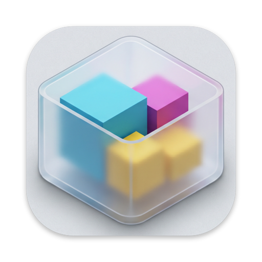
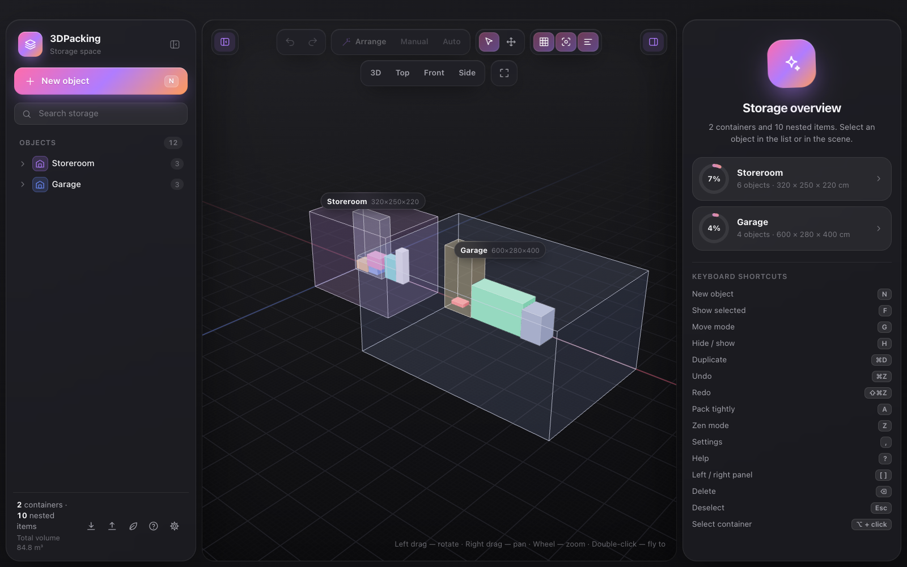
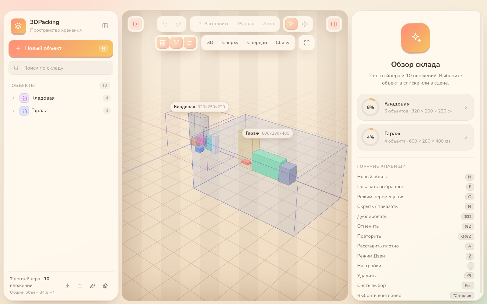

<p align="center">
  
</p>

<h1 align="center">3DPacking</h1>

<p align="center">
  <b>Je opslag, in 3D.</b><br>
  Kamers, kasten en dozen passen in elkaar. Zet spullen zelf neer — of laat het programma ze compact inpakken.
</p>

<p align="center">
  <a href="../README.md">English</a> ·
  <a href="README.ru.md">Русский</a> ·
  <a href="README.uk.md">Українська</a> ·
  <a href="README.de.md">Deutsch</a> ·
  <b>Nederlands</b> ·
  <a href="README.fr.md">Français</a> ·
  <a href="README.es.md">Español</a>
</p>

<p align="center">
  <a href="https://github.com/unibronga/3DPacking/releases/latest"></a>
  
  
  <a href="../LICENSE"></a>
</p>

<p align="center">
  
</p>

## Waarom

Je weet dat die doos met kabels *ergens* in de berging staat. 3DPacking houdt een levend 3D-model bij van je kamers, kasten, stellingen en dozen: wat erin zit, hoeveel ruimte er over is, en een foto van elk ding. Het is een desktopprogramma — alle gegevens blijven op je eigen computer.

## Functies

- 🧱 **Geneste containers** — kamers, kasten, stellingkasten, dozen en spullen, zo diep genest als je wilt. Vulringen tonen hoeveel ruimte in gebruik is.
- 🖱️ **Handmatig plaatsen** — sleep spullen direct in de scène: ze vallen op de vloer en op elkaar, klikken vast aan wanden en buren en gaan in een kast of doos als je ze erboven loslaat.
- 📦 **Compact automatisch inpakken** — 3D bin packing: extreme punten, minstens 70 % steun, rotaties, ‘lege’ voorwerpen mogen op hun kant, volgorde-heuristieken en lokaal zoeken binnen een tijdsbudget. Zet een container op **Auto** en hij pakt zich bij elke wijziging opnieuw in.
- 🔍 **Makkelijk navigeren** — selecteren door transparante wanden, de camera naar elk object laten vliegen, weergaven 3D / boven / voor / zijkant, kruimelpad, zoeken.
- 📷 **Foto’s, notities en eigen velden** — plak of sleep een foto op elk object (lokaal bewaard, gecomprimeerd naar WebP), voeg notities en eigen velden toe.
- ↩️ **Veilig experimenteren** — automatisch bewaren, herstellen en opnieuw voor alles (een hele sleepbeweging is één stap), JSON-export en -import inclusief foto’s.
- 🎨 **Zoals jij het wilt** — zes thema’s van Grafiet tot PixelArt, acht achtergrondtexturen, Zen-modus, interfacegrootte 80–200 %, pixel-3D.
- 🌍 **Zeven talen** — English, Русский, Українська, Deutsch, Nederlands, Français, Español — inclusief het menu en de ingebouwde help (`F1` of `?`).

<p align="center">
  
</p>

## Downloaden

Haal **3DPacking-mac-arm64.zip** uit de [nieuwste release](https://github.com/unibronga/3DPacking/releases/latest), pak het uit en zet **3DPacking.app** in Apps.

> De app is ondertekend met een Developer ID en genotariseerd door Apple — hij opent zoals elke andere Mac-app.

## Zelf bouwen

Vereist Node.js 20+.

```bash
npm install
npm run dev       # in de browser: http://localhost:5288
npm run desktop   # Electron-venster
npm run app       # release/mac-arm64/3DPacking.app
npm run i18n      # controleren dat elke taal alle teksten heeft
```

## Sneltoetsen

| Toets | Actie | Toets | Actie |
| --- | --- | --- | --- |
| `N` | Nieuw object | `A` | Compact inpakken |
| `F` | Selectie tonen | `Z` | Zen-modus |
| `G` | Verplaatsmodus | `,` | Instellingen |
| `H` | Verbergen / tonen | `?` / `F1` | Help |
| `⌘D` | Dupliceren | `[` `]` | Linker- / rechterpaneel |
| `⌘Z` / `⇧⌘Z` | Herstel / opnieuw | `⌥` + klik | Container kiezen |
| `⌫` | Verwijderen | `Esc` | Selectie opheffen |

## Onder de motorkap

Vite + puur JavaScript + [three.js](https://threejs.org) r180 + Electron — zonder frameworks.

| Bestand | Wat het doet |
| --- | --- |
| `src/store.js` | Gegevens: platte lijst met `parentId`, maten en posities in cm, herstellen via snapshots |
| `src/packing.js` | Compact 3D-inpakken |
| `src/viewport.js` | Scène, selectie, slepen met zwaartekracht en vastklikken, cameravluchten |
| `src/i18n.js`, `src/locales/` | Talen: de sleutel is de Russische tekst, elk woordenboek geeft de vertaling |
| `src/ui/` | Boom links, inspector, dialogen, instellingen, help |
| `electron/` | Programmavenster en vertaald menu |

### Een taal toevoegen

Kopieer `src/locales/en.js`, vertaal de waarden, voeg de taal toe aan `LANGS` in `src/i18n.js` en aan `electron/menu-i18n.cjs`, en voer `npm run i18n` uit.

## Licentie

[MIT](../LICENSE) © 2026 Kostiantyn
